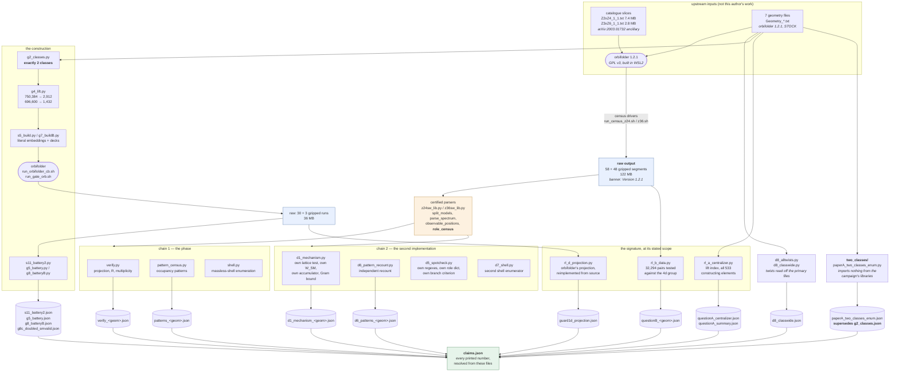

# Data flow — from catalogue to printed number

Two independent chains produce the paper's numbers. They share the catalogue and the raw
output; they share nothing downstream of the parser except the Standard-Model
identification, and that shared layer is named explicitly below because it is the paper's
main inherited assumption.

---

## 1. The whole thing, at a glance



---

## 2. The same thing as text, for one number

Take **104,889** — the count of fields carrying a norm-6/5 Standard-Model role.

```
arXiv:2003.01732 ancillary
  Z2xZ4_OrbifoldMSSMs.tar.xz
        |  (extract)
        v
  data/literature/parr2020_full/extracted/Z2xZ4_1_1.txt        7,560,329 bytes
        |                                       SHA-256 6c73de64...d2b7d, recorded in
        |                                       z24sw_lib.CATALOGUE_SHA256 and checked by
        |                                       z2xz4_sweep/selftest.py check S11
        |                                       (NOT enforced at parse time)
        |  awk splits the file into 58 segments of ~200 models
        |  wsl -d Ubuntu -- bash run_census_z24.sh <SEG> <FIRST> <LAST>
        |     BIN = ~/rcharge_build/src/orbifolder/orbifolder
        |     GEO = Geometry_Z2xZ4_1_1.txt   (STOCK)
        |     command block: spectrum print(F) with internal information,
        |                    gauge group, U1 generators, simple roots, anomaly info,
        |                    analyze config, use config(SMConfig), print summary
        v
  data/z2xz4_sweep/raw/census/census_seg0..57.txt.gz           78.2 MB
        |  banner asserts "The C++ Orbifolder / Version: 1.2.1"
        |
        |  z24sw_lib.split_models, parse_spectrum, parse_gauge_factors,
        |  parse_smconfig, cfgs[0], observable_positions, role_census
        v
  per-record: sector (k,l), fixed point n_a, p_sh (16 rationals), role
        |
        |  verify.py: W = span(SU(3)_c Cartan, SU(2)_L Cartan, t_Y)
        |             w = P_W p          (EXPLICIT PROJECTION, exact rationals)
        |             |w|^2 accumulated per role family
        v
  data/su5_ten_bound/verify_Z2xZ4_1_1.json :: w2_by_fam["10"]["6/5"] = 67,555
  data/su5_ten_bound/verify_Z3xZ6_1_1.json :: w2_by_fam["10"]["6/5"] = 37,334
        |
        |  67,555 + 37,334
        v
  104,889                                     claims.json :: A-05
```

`claims.json` stores that derivation explicitly, in the `derivation` field, and
recomputes the sum when the file is built — so the arithmetic is checked, not asserted.

---

## 3. What the two chains share, and what they do not

This is the honest scope of the word "independent".

**Shared, byte for byte:** `split_models`, `parse_spectrum`, `parse_gauge_factors`,
`parse_smconfig`, the `cfgs[0]` selection, `observable_positions` (the Standard-Model
identification), `role_census` (the hypercharge orientation and the role labels), and the
`(sector, n_a)` cell key.

**Independent:** the `E8 x E8` root system and local-group machinery, the lattice
membership test, the Weyl-group construction and search, `B = |p_sh|^2/2`, the projection
`|w|^2`, `R = 2B − |w|^2`, the twist vectors, the accumulator, and — in `d5_spotcheck.py`
— the regexes, the role dictionary and the chirality branch criterion.

So reproducing 67,555 across the two chains confirms the **counting layer** and not the
identification layer. The real independent evidence for the identification is different
and stronger: `|w|^2` lands on exactly `6/5` or `4/5` on all 481,728 fields with no
exception, which a wrong hypercharge orientation could not do. That is the sentence to
quote, and `d5_spotcheck.py`'s 160-of-161 agreement under an independent role dictionary
is the second.

**Inherited, and not re-opened by this package:** the Standard-Model identification
itself. Both chains take `role_census`'s assignment verbatim.

---

## 4. Where `delta_c` enters, and where it does not

A common misreading. `B` is computed from the **printed** `p_sh`:

```
B = |p_sh|^2 / 2
R = 2B - |w|^2
```

`delta_c` — the vacuum-energy shift computed from the geometry file's twist vectors —
enters **only** the invariant check `I1` (`|p_sh|^2/2 = 1 − delta_c − N_osc`), which
passed 481,728 / 481,728 exactly. No violation count, `R` histogram, multiplicity or
unprotected cell can move if a twist vector were wrong; only the narrative that attributes
budget windows to named sectors would.

The twists are separately cross-checked: `d8_classwide.py` reads them off the primary
geometry files with a per-row provenance record (file and line), and the per-sector
*maximum* measured budget reproduces the recomputed oscillator-free budget in **every
populated sector** of both geometries — six and thirteen respectively.

---

## 5. The two branches that do not go through the parsers

Two parts of the package take a different route to the same claim map, and that is the
point of them.

**`two_classes/`** starts from the **geometry file alone**. It re-derives the twist
vectors, the budget box, the `E8 x E8` root system, the ten norm-6/5 weights, the class
key and the equivalence group from scratch, and enumerates the shift classes admitting the
configuration without importing anything from `su5_construction/` or
`gate_su5_construction/`. It runs its own invariant checks first — the `E8` theta series
`1, 240, 2160, 6720`; the class key verified invariant under 200 random lattice
translations *and* verified not to identify `x` with `x + e_1` — and only then counts. It
reaches the same endpoint (**two** classes) by a different road, and finds two errors in
the intermediate counts on the way, which is exactly what an independent re-derivation is
for. It reconciles with the published enumeration explicitly, restricted to that
enumeration's own subset.

**`code/root_lift/`** shares the raw output but not the question. It asks whether the
separating root is a root of the **four-dimensional** group, which no other script in the
package computes, and it needs the space-group algebra — centralisers, Smith normal form,
Wilson-line orders derived from the point-group matrices — rather than the spectrum
parsers' role layer. Its guard `1d` closes the loop the other way: it reimplements
orbifolder's own projection formula from `orbifolder-1.2.1/src/` and checks that the
formula reproduces orbifolder's **printed** spectrum, 112 `(cell, q_sh)` groups on the two
constructed models, including the load-bearing one. It also recounts the same-role pair set
under one uniform convention, which is where **32,294** comes from.
